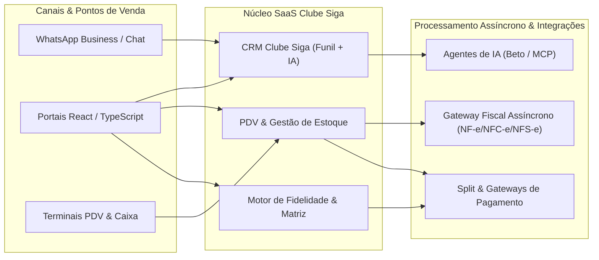

# 🏢 Case Study Arquitetural — Ecossistema Clube Siga (CRM AI-First, PDV Fiscal & Afiliados)

> **Nota de Governança:** Este repositório público apresenta a arquitetura, decisões de engenharia e especificações técnicas da suíte comercial **Clube Siga**. Os repositórios de produção permanecem privados por conformidade de segurança e propriedade intelectual.

---

## 🎯 Visão Geral do Ecossistema

O **Ecossistema Clube Siga** integra três pilares de operação comercial e relacionamento em produção:

1. **💬 [CRM Clube Siga (`crm.clubesiga.com.br`)](https://crm.clubesiga.com.br):** Plataforma Multiempresa *AI-First* para gestão de funil de vendas, atendimento omnichannel via WhatsApp e automação comercial assistida por agentes de IA nativos (pronta para **Model Context Protocol — MCP**).
2. **🧾 PDV Clube Siga:** Sistema de Gestão Comercial, Controle de Estoque e Frente de Caixa com motor fiscal desacoplado e assíncrono (`NF-e`, `NFC-e` e `NFS-e` via webhooks idempotentes e certificados digitais A1).
3. **🤝 App Clube Siga (`app.clubesiga.com.br`):** Plataforma SaaS de fidelidade, cashback, árvore unilevel e matriz forçada com ledger financeiro auditável e proteção contra condições de corrida (*atomic row-level locking*).

---

## 🏗️ Arquitetura Técnica & Decisões de Engenharia

### Destaques de Senioridade Aplicados
- **Idempotência Determinística por Entidade:** Todas as operações financeiras, emissões fiscais e bonificações utilizam chaves de idempotência derivadas de identificadores de domínio, eliminando duplicidades em retentativas de fila.
- **Segurança Purple-Team & LGPD:** Isolamento estrito por `tenant_id`, validação contra *BOLA/IDOR*, segredos injetados exclusivamente em runtime via *Docker Swarm Secrets* e trilha de auditoria imutável.
- **Observabilidade Full-Stack (LGTM):** Monitoramento contínuo com **Grafana**, **Prometheus**, **Loki**, **Alloy** e **cAdvisor** integrados ao esquadrão de resposta a incidentes da plataforma de agentes.

---

## 🛠️ Stack Tecnológica

